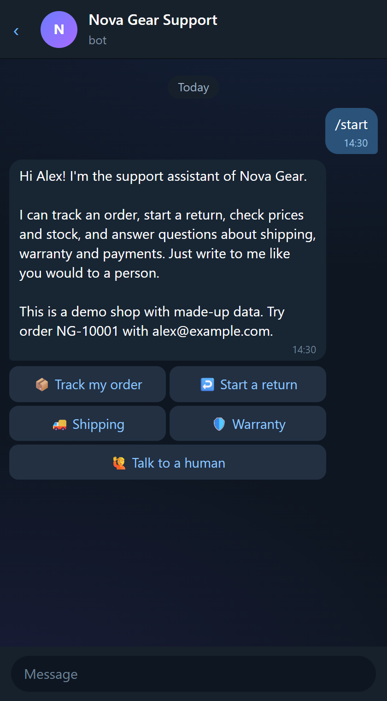
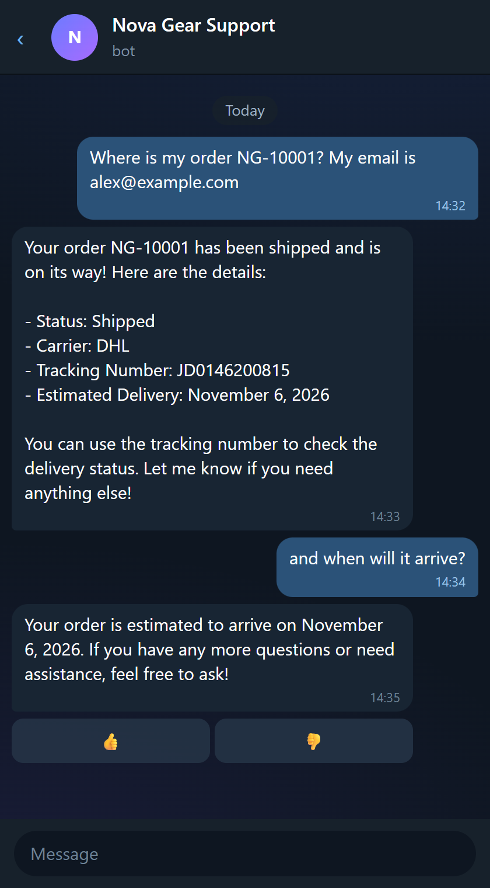
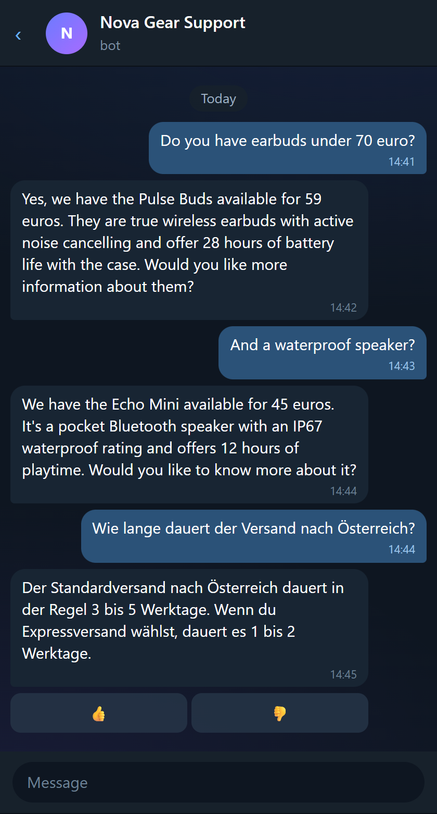
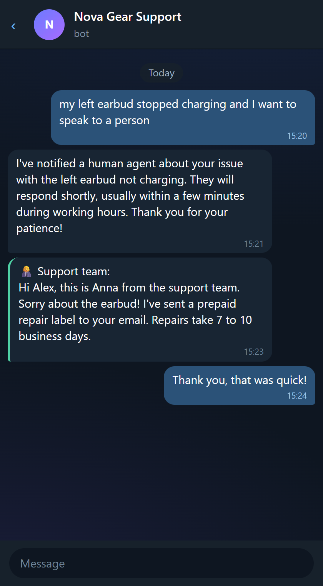
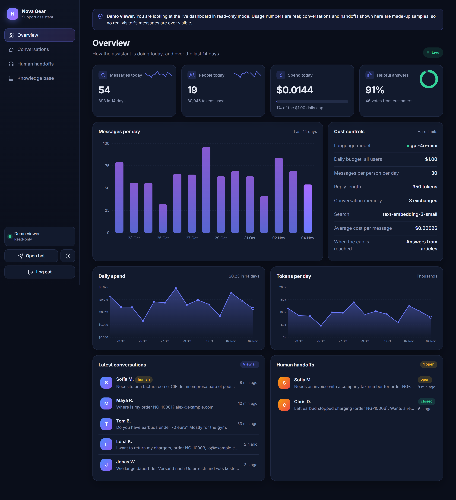
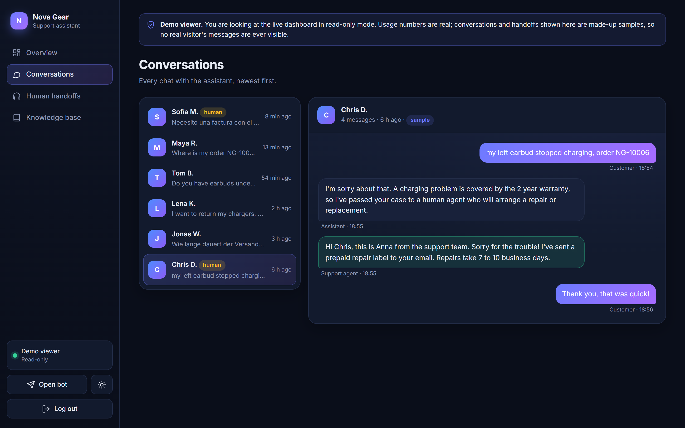
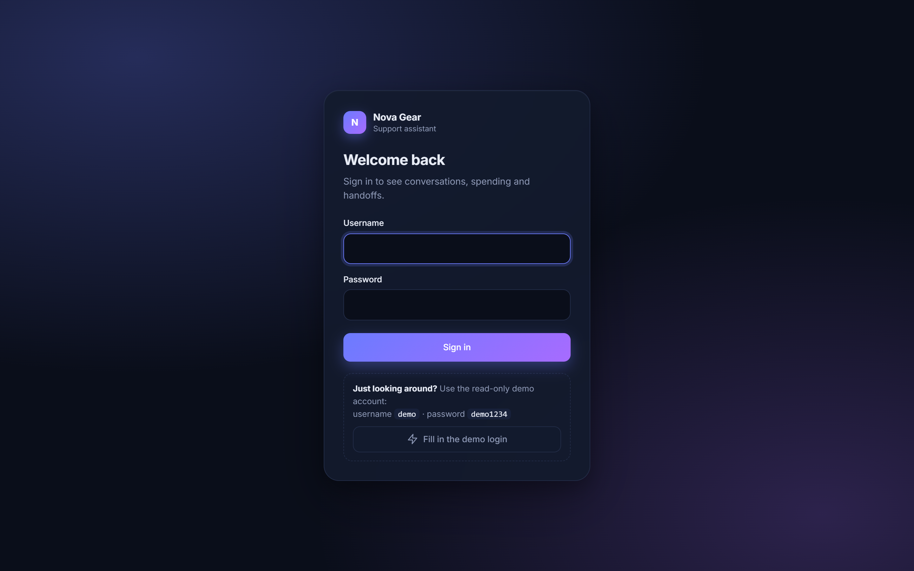
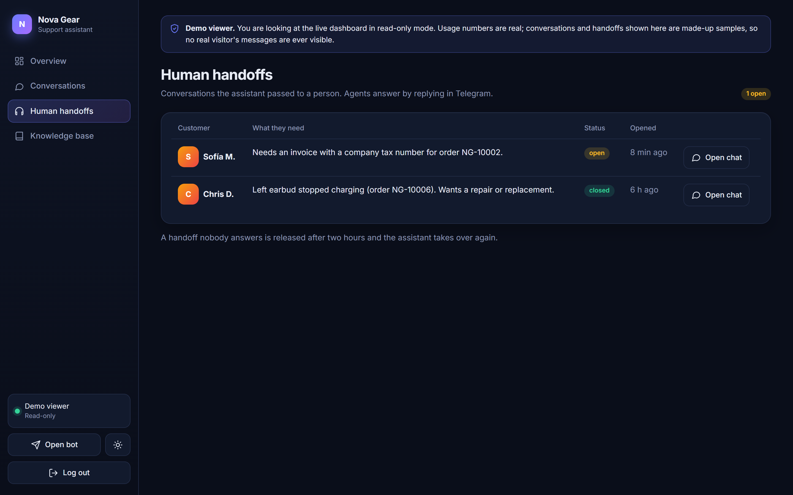
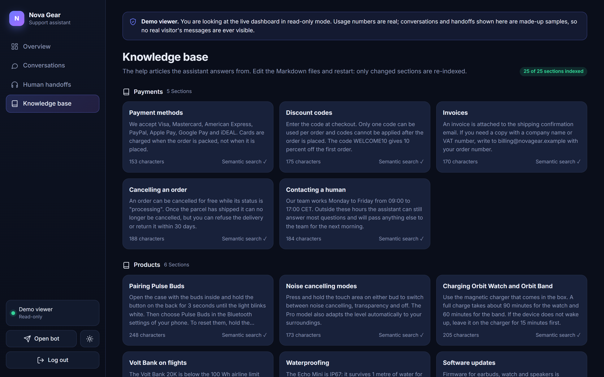

# Support Assistant Bot (Telegram)

A customer-support bot for an online shop, built with Python. It answers from a knowledge base, looks up orders, registers returns, searches the catalogue, and hands the conversation to a human when it should. It has hard spending limits, so a public demo cannot run up a bill.

The shop in the demo ("Nova Gear") and all its orders are made up.

**Try it**

- Telegram bot: [@novagear_help_bot](https://t.me/novagear_help_bot). Send `/start`, then ask about order `NG-10001` with the email `alex@example.com`.
- Admin dashboard (read-only demo): https://nova-assistant.150-230-43-127.sslip.io/admin
  username `demo`, password `demo1234`

## What it does

- **Answers from your own documents.** Help articles are plain Markdown files in `knowledge/`. They are split into sections and searched by meaning (embeddings). The best sections are given to the model with every question, and the bot shows which article it used.
- **Takes real actions through tools.** The model can check an order, find products with price and stock, register a return, or call a human. Every tool validates its own input: an order is shown only when the email matches, returns follow the 30-day window, and a return cannot be registered twice.
- **Human handoff.** The customer's messages are forwarded to a support chat. The agent replies by replying to the forwarded message, and `/close 12` hands the customer back to the bot. A handoff nobody answers is released after two hours.
- **Remembers the conversation** (the last few turns), with `/reset` to forget it.
- **Quick buttons and feedback.** Inline buttons for the common questions, and a 👍/👎 under every answer.
- **Admin dashboard** with its own login page: messages, people, tokens and spend against the budget, helpful-answer rate, a chat-style viewer for conversations, handoffs and the knowledge base. Dark and light themes, works on phones. The demo account is read-only and only shows sample conversations, never real visitors' messages.
- **Replies in the customer's language.**

## Screenshots

<p>
  
  
  
  
</p>

*The chat images are Telegram-style renderings of real replies generated by the bot (the order, product, shipping and handoff answers are unedited model output).*



<p>
  
  
</p>
<p>
  
  
</p>

## Cost controls

| Guard | Default |
| --- | --- |
| Messages per person per day | 30 |
| Spend per day, all users | $1.00 |
| Reply length | 350 tokens |
| Customer message length | 600 characters |
| Conversation memory | last 8 exchanges |
| Flood protection | 6 messages per 12 seconds |

When the daily budget is reached, the bot does not go quiet: it switches to answering straight from the knowledge base, with no model call. Without an API key it runs in that mode all the time, so it works (and is testable) with no account at all.

## Safety

- The system prompt limits the bot to shop topics and tells it to treat customer text, policy excerpts and tool results as data, not instructions.
- Private data sits behind code, not behind the prompt: order lookups require the matching email in the tool itself.
- Input is length-limited and unknown tools or bad arguments return an error instead of crashing.
- The Telegram webhook is verified with a secret token. The dashboard uses a signed, HTTP-only session cookie, constant-time password checks and a lockout after repeated wrong passwords.

## How it works

```
Telegram ──webhook──▶ FastAPI ──▶ aiogram handlers ──▶ Agent
                                     │                   ├─ knowledge base (SQLite + embeddings)
                                     │                   ├─ tools: orders, products, returns, handoff
                                     │                   └─ language model (OpenAI)
                                     └─ human handoff relay to the support chat
```

| File | Role |
| --- | --- |
| `app/agent.py` | Conversation loop, guards, tool round-trips, usage accounting |
| `app/tools.py` | The actions the model may take, each one validated |
| `app/kb.py` | Markdown sections, embeddings, search (with a keyword fallback) |
| `app/llm.py` | The only place that talks to the model API |
| `app/bot.py` | Telegram commands, buttons, handoff relay |
| `app/web.py` | Webhook, health check, nightly demo reset |
| `app/admin.py`, `app/templates/` | Dashboard: login, session cookie, pages, charts |
| `app/samples.py` | Made-up history (conversations, handoffs, usage) for the demo dashboard |
| `app/db.py`, `app/seed.py` | SQLite storage and the demo shop |

## Run it

You need Python 3.12+, a bot token from [@BotFather](https://t.me/BotFather) and, for the language model, an OpenAI API key.

```bash
python -m venv .venv
.venv/Scripts/activate        # Linux/macOS: source .venv/bin/activate
pip install -r requirements-dev.txt
cp .env.example .env          # then fill in TELEGRAM_TOKEN and OPENAI_API_KEY
uvicorn app.web:create_app --factory
```

With no `PUBLIC_URL` the bot polls Telegram, so it works from a laptop with no domain. To run it as a webhook behind HTTPS, set `PUBLIC_URL` and the app registers the webhook itself.

Send `/id` to the bot to find your chat id, put it in `ADMIN_CHAT_ID`, and handoffs arrive there. Set `ADMIN_PASSWORD` for the dashboard (the `demo` login can be changed with `DEMO_USER` / `DEMO_PASSWORD`, or turned off by leaving `DEMO_USER` empty).

### Docker

```bash
docker build -t support-bot .
docker run -d --name support-bot --env-file .env -p 127.0.0.1:8000:8000 -v support-data:/app/data support-bot
```

### Tests

```bash
pytest
```

The tests use a scripted stand-in for the model, so they need no API key and cost nothing. They cover retrieval, every tool rule, the spending guards (per-person limit, daily budget, runaway tool loops), conversation memory and the web endpoints.

## Make it your own

Replace the files in `knowledge/` with your own help articles (use `##` headings, one topic per section), change the catalogue in `app/seed.py` or point the tools at your real shop API, and set `SHOP_NAME`. The rest stays as it is.
